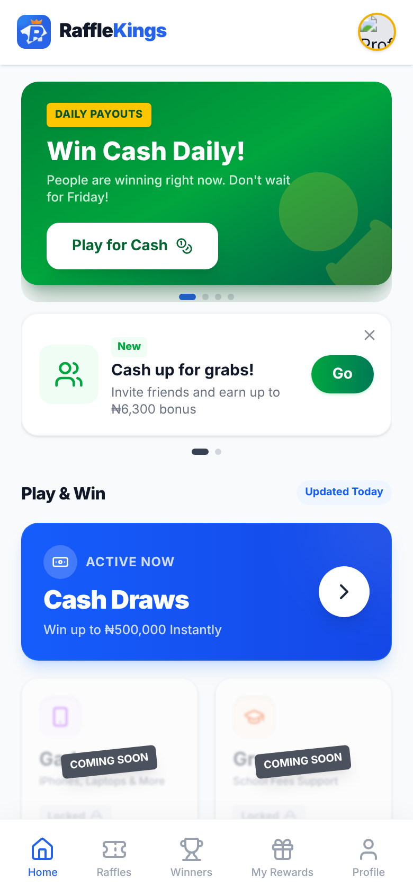

# RaffleKings

[](https://github.com/adeniyi-faith/RaffleKings/actions/workflows/ci.yml)
[](https://github.com/adeniyi-faith/RaffleKings/actions/workflows/raffle-api-tests-mysql.yml)

RaffleKings is a raffle website for players in Nigeria. People top up a wallet, buy tickets, pick their lucky numbers, watch the draw, and withdraw cash prizes (up to ₦500,000) to their bank account. It runs live at [rafflekings.com.ng](https://rafflekings.com.ng).

<p align="center"></p>

## The problem it solves

Small raffles are usually run through chat groups and bank transfers. Players have to trust the organiser, tickets get lost, and nobody can check that the winner was picked fairly. RaffleKings puts the whole thing in one place: payments, tickets, draws, winners and payouts are recorded by the system, and staff have an admin panel to run it and a trail of who did what.

## What it does

**For players**
- Wallet top-ups by card or bank transfer, and withdrawals to a saved bank account
- Browse raffles, pick numbers, buy tickets in a few taps
- Live draws with results that can be checked afterwards, and a Winners / Hall of Fame page
- Daily rewards, points, referrals and affiliate earnings
- In-app support and a Learning Hub of help guides
- Works on a phone like an app (installable web page)

**For staff (admin panel)**
- Create and run raffles, draws and winners
- Review deposits, withdrawals and payment mismatches; every balance change is logged
- Customer support tickets, an AI-assisted support agent, and a knowledge base
- Member segments, comeback offers, notices and an on-site ads engine
- Staff roles, a team to-do list and compliance case notes

## Built with

| Part | Tool |
| --- | --- |
| Back end | PHP 8.4 and [Laravel](https://laravel.com) 13 |
| Front end | React 19 with [Inertia](https://inertiajs.com) (pages are served by Laravel), Tailwind CSS 4, built with Vite |
| Admin panel | [Filament](https://filamentphp.com) 3 |
| Database | MySQL |
| Payments | Paystack and Flutterwave |
| Extras | Laravel Reverb (live updates), OneSignal (push notifications), Sentry (error tracking), Google Gemini (AI helpers) |
| Checks and deploy | GitHub Actions |

## Run it on your computer

You need PHP 8.3 or newer, Composer, Node.js and an empty MySQL database.

```bash
cd raffle-api && cp .env.example .env     # then open .env and fill in the DB_ lines
composer setup && composer dev            # installs and builds, then starts http://localhost:8000
```

Full steps, the test commands and common problems are in [docs/setup.md](docs/setup.md).

## Where things are

```
raffle-api/   the whole website: pages, admin panel, payments, tests
docs/         setup, how it fits together, project history
.github/      automatic checks and the deploy to the live server
```

(The folder is called `raffle-api` for historical reasons. It is the entire website, not only an API.)

## Learn more

- [How it is put together](docs/architecture.md)
- [Set it up and run the tests](docs/setup.md)
- [Contributing](CONTRIBUTING.md)
- [Project history: the move off WordPress](docs/history.md)

## Licence

Copyright (c) 2026 Rks Digital Innovation. All rights reserved. The code is published to show how the project was built. You may not copy, run or redistribute it without written permission. See [LICENSE](LICENSE).
